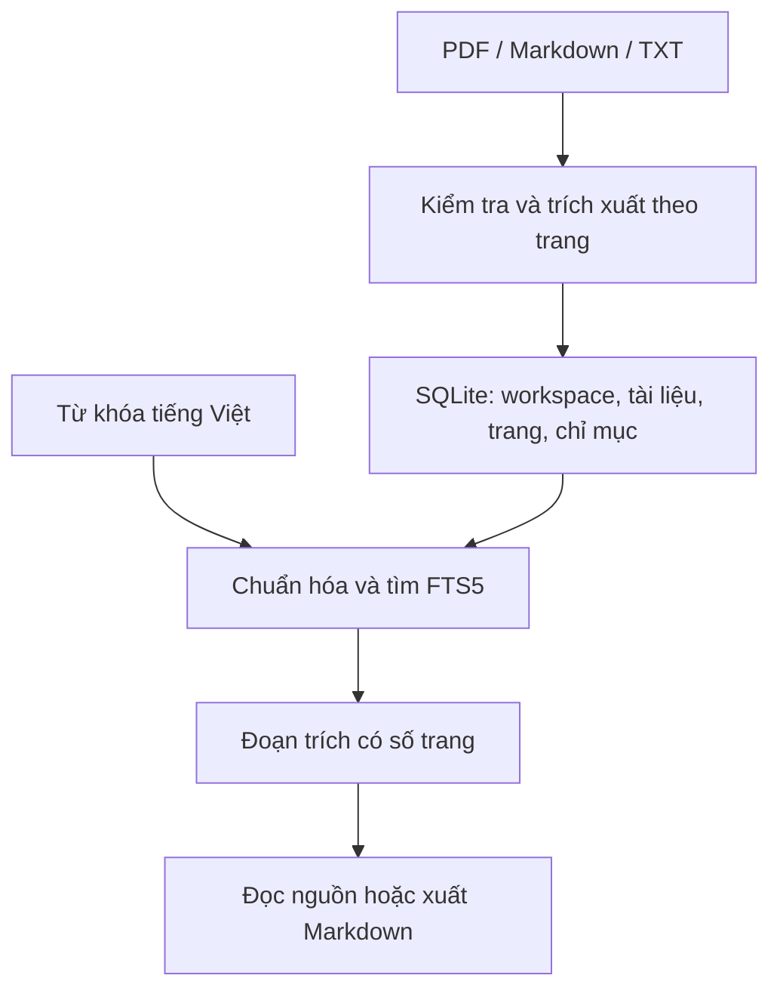
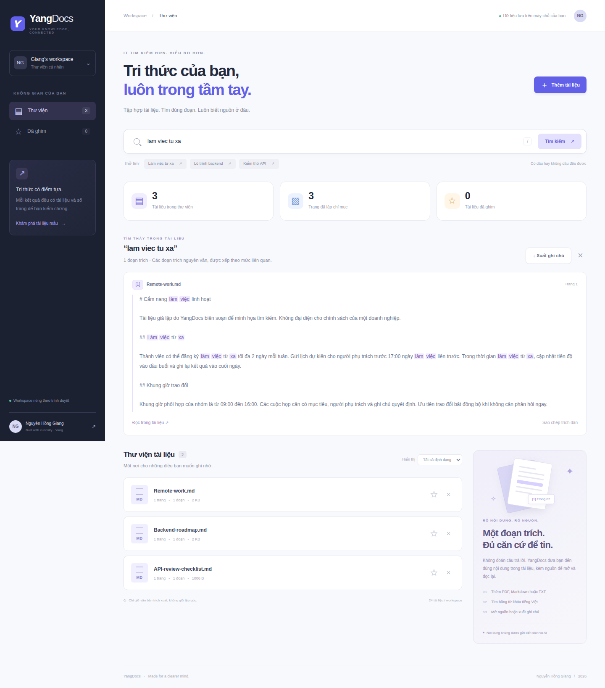

<div align="center">

# YangDocs

**Tài liệu của bạn. Kết quả có nguồn.**

Thư viện tài liệu cá nhân với tìm kiếm tiếng Việt, trích dẫn theo trang,
ghim tài liệu và xuất ghi chú Markdown.

Python 3.12 · FastAPI · SQLite FTS5 · Vanilla JavaScript

[Tính năng](#tính-năng) · [Chạy thử](#chạy-thử) · [Kiểm thử](#kiểm-thử) · [Nguồn gốc](#nguồn-gốc)

</div>


## Tính năng

- Tải PDF có lớp văn bản, Markdown và TXT UTF-8. Tối đa **5 MB**, **80 trang**, **800.000 ký tự** và **24 tài liệu/workspace**.
- Tìm kiếm tiếng Việt có dấu hoặc không dấu, bao gồm `đ` → `d`, với xếp hạng theo độ phủ từ khóa và BM25.
- Mỗi kết quả là **đoạn trích nguyên văn** có tên tài liệu và số trang. Mở trang nguồn để kiểm tra hoặc xuất ghi chú `.md` kèm trích dẫn.
- Ghim tài liệu, lọc thư viện theo định dạng, xóa đồng thời văn bản và chỉ mục.
- Workspace riêng theo cookie trình duyệt, giữ trong 7 ngày. Mọi thao tác tài liệu đều kiểm tra quyền sở hữu.
- Giao diện tiếng Việt trên desktop và mobile, điều khiển bằng bàn phím, trạng thái trống/lỗi/đang xử lý.
- Bộ 3 tài liệu mẫu giả lập, thêm bằng nút trong ứng dụng, không tự đưa dữ liệu vào mọi workspace.

**Chế độ hiện tại là tìm kiếm từ khóa và trích xuất bằng chứng, không phải mô hình
sinh câu trả lời hay tìm kiếm ngữ nghĩa. Không cần API key, không tải model và
không gửi nội dung tài liệu đến dịch vụ AI.** Văn bản được lưu trên máy chủ chạy
ứng dụng; không phải lưu riêng bên trong trình duyệt. PDF ảnh quét cần OCR bên ngoài.

## Chạy thử

### Python

```bash
git clone --branch yangdocs-preview --single-branch https://github.com/nguyenhonggiang2407/DTDD.git YangDocs
cd YangDocs
python -m venv .venv
source .venv/bin/activate
# Windows PowerShell: .venv\Scripts\Activate.ps1
pip install -r requirements.txt
uvicorn app.main:app --reload --host 127.0.0.1 --port 8000
```

Mở <http://127.0.0.1:8000>, chọn **Thử bộ tài liệu mẫu**, rồi tìm
`lam viec tu xa` hoặc `backend`. Không cần đăng ký tài khoản hay cấu hình dịch vụ khác.

Mã YangDocs hiện được lưu ở nhánh độc lập `yangdocs-preview` của repo DTDD.
Nhánh `main` của repo tiếp tục chứa dự án YangCareer. Có thể chuyển nguyên
nội dung nhánh này sang repo YangDocs riêng khi repo mới được tạo.

### Docker

```bash
docker compose up --build
```

Compose chỉ mở cổng trên loopback, lưu SQLite trong named volume và giới hạn
CPU/RAM cho bộ trích xuất PDF. Dừng bằng `docker compose down`; volume vẫn được giữ.
Không commit thư mục `data/`, file `.env` hoặc tài liệu thật lên GitHub.

## Kiến trúc



`app/workflow.py` tách ba bước ingest → retrieve → present. Tệp gốc không được
ghi xuống đường dẫn do người tải cung cấp; chỉ lưu metadata, văn bản từng trang
và đoạn tìm kiếm. Một giao dịch ghi tài liệu cùng chỉ mục. Khóa ngoại và trigger
FTS bảo đảm xóa dữ liệu không để lại kết quả cũ.

| Đường dẫn | Vai trò |
|---|---|
| `app/main.py` | API, phiên, CSRF, Origin, export và phục vụ giao diện |
| `app/workflow.py` | Kiểm tra tệp, chia đoạn, chuẩn hóa tiếng Việt, tìm nguồn |
| `app/store.py` | SQLite, phiên có thời hạn, quyền sở hữu và FTS5 |
| `app/limits.py` | Giới hạn request trước bộ phân tích multipart |
| `app/static/` | UI responsive, hiển thị nội dung bằng DOM text an toàn |
| `tests/` | Kiểm thử API và trình duyệt thật |
| `upstream/workflow.py` | Bản tham chiếu MIT gốc, không chạy trong ứng dụng |

## API chính

Lấy `GET /api/session` để nhận cookie HttpOnly và token `csrf`. Gửi token trong
header `X-CSRF-Token` cho các yêu cầu ghi và tìm kiếm. Các API khác yêu cầu phiên.
Định nghĩa máy đọc được nằm ở `GET /openapi.json`.

| Phương thức | Endpoint | Chức năng |
|---|---|---|
| GET | `/api/documents` | Danh sách và thống kê workspace hiện tại |
| POST | `/api/documents` | Multipart upload với trường `file` |
| PATCH | `/api/documents/{id}` | `{"favorite": true}` |
| DELETE | `/api/documents/{id}` | Xóa tài liệu và chỉ mục |
| GET | `/api/documents/{id}/pages/{number}` | Văn bản trang nguồn |
| POST | `/api/search` | `{"query":"lam viec tu xa","favorites":false}` |
| POST | `/api/export` | Cùng payload tìm kiếm, tải Markdown |
| POST | `/api/demo` | Thêm bộ tài liệu mẫu vào workspace hiện tại |
| GET | `/health` | Health check không tiết lộ dữ liệu |

## Kiểm thử

```bash
pip install -r requirements-dev.txt
ruff check app tests
ruff format --check app tests
python -m pytest tests/test_documents.py -q
python -m playwright install chromium
python -m pytest tests/test_ui.py -q
```

API tests kiểm tra quyền sở hữu trên mọi thao tác, CSRF/Origin, upload lỗi/lớn/
trùng, PDF mã hóa/ảnh quét, số trang thực của PDF nhiều trang, tìm không dấu,
lọc tài liệu ghim, export, giới hạn tài liệu, phiên hết hạn và xóa khỏi FTS.
Browser tests thực hiện upload → ghim → xem nguồn → hủy/xác nhận xóa, tìm kiếm
→ đọc trích dẫn → tải Markdown, render nội dung chứa HTML dưới dạng văn bản,
kiểm tra overflow mobile và chụp giao diện thật. CI tạo ảnh bên dưới sau khi kiểm thử đạt.

<details>
<summary>Ảnh tìm kiếm và giao diện mobile</summary>




</details>

## Phạm vi và cấu hình

Đây là ứng dụng portfolio cho sử dụng cá nhân hoặc chạy cục bộ. Workspace dựa
vào cookie, **không thay thế đăng nhập tài khoản**. Xóa cookie làm mất quyền truy
cập workspace cũ. Phiên hết hạn không đọc được dữ liệu; dữ liệu hết hạn được dọn
khi tạo phiên mới. Không có đồng bộ nhiều thiết bị hay OCR, semantic search, LLM.

| Biến môi trường | Mặc định | Mục đích |
|---|---|---|
| `YANGDOCS_DB` | `data/yangdocs.sqlite3` | Vị trí cơ sở dữ liệu |
| `YANGDOCS_ALLOWED_HOSTS` | `localhost,127.0.0.1,testserver` | Host được phép, phân tách bởi dấu phẩy |
| `YANGDOCS_SECURE_COOKIE` | `0` | Đặt `1` khi phục vụ qua HTTPS |

Nếu triển khai công khai, cần thêm đăng nhập, quota/rate limit ở reverse proxy,
HTTPS và cookie Secure, lịch dọn dữ liệu, sao lưu và giới hạn tài nguyên cho PDF.
Bản hiện tại chưa được kiểm thử tải lớn hoặc triển khai internet công khai.

## Nguồn gốc

Phát triển cho [**Nguyễn Hồng Giang**](https://github.com/nguyenhonggiang2407).
Kiến trúc ingest/retrieve/synthesize tham khảo ví dụ MIT trong
[patchy631/ai-engineering-hub](https://github.com/patchy631/ai-engineering-hub),
được tiếp cận qua fork [Trinhvhao/ai-engineering-hub](https://github.com/Trinhvhao/ai-engineering-hub).
YangDocs viết lại runtime và giao diện, bổ sung quản lý tài liệu và kiểm thử;
không nhận công trình upstream là tự viết. Xem thay đổi và snapshot tại
[NOTICE.md](NOTICE.md). Giữ nguyên [MIT License](LICENSE) và tên tác giả gốc.
