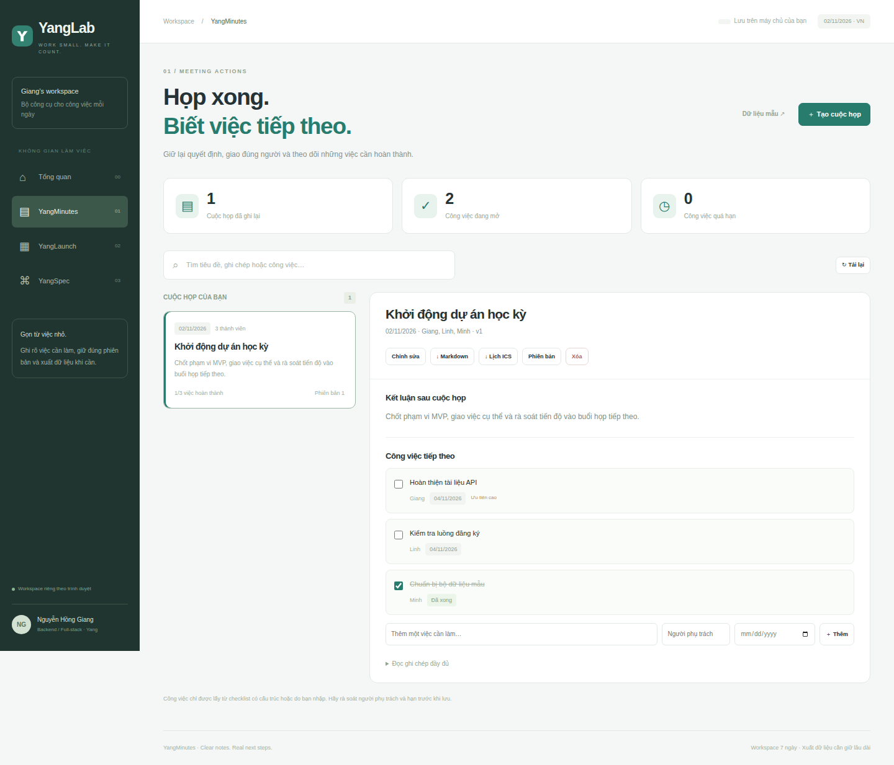
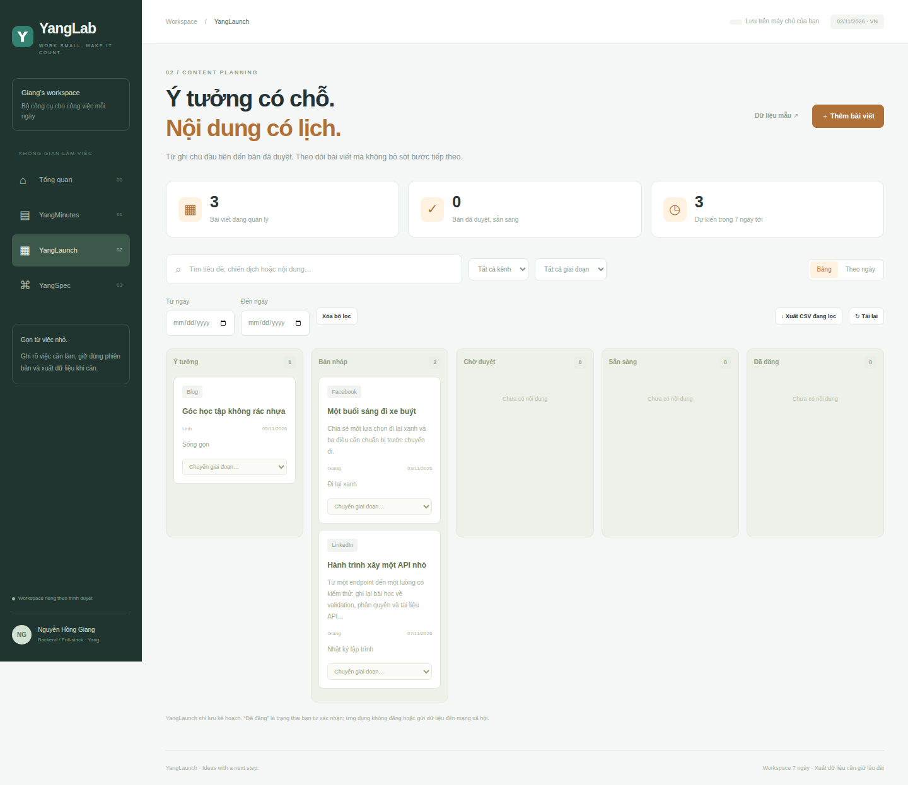
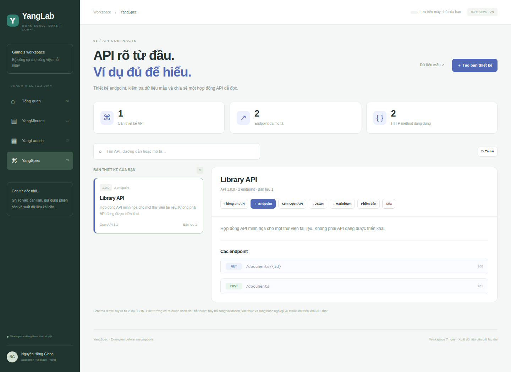

<div align="center">

# YangLab

**Ba không gian. Một cách làm việc rõ ràng.**

YangMinutes · YangLaunch · YangSpec

Node.js 24 · SQLite · JavaScript · Không có dependency runtime bên ngoài

[Chạy thử](#chạy-thử) · [Các ứng dụng](#các-ứng-dụng) · [Kiểm thử](#kiểm-thử) · [Ghi nguồn](NOTICE.md)

</div>

YangLab là monorepo gồm ba ứng dụng nhỏ phục vụ công việc nhóm, kế hoạch nội
dung và thiết kế API. Mỗi ứng dụng có domain, giao diện và README riêng; chúng
dùng chung HTTP server, SQLite, phiên workspace, kiểm soát phiên bản và CI.
Mã hiện được lưu trên nhánh **yanglab** của repo DTDD.

## Các ứng dụng

| Ứng dụng        | Chức năng có thể dùng ngay                                                             | Tài liệu                              |
| --------------- | -------------------------------------------------------------------------------------- | ------------------------------------- |
| **YangMinutes** | Biên bản họp, checklist có cấu trúc, công việc có người phụ trách/hạn, Markdown và ICS | [README](apps/yang-minutes/README.md) |
| **YangLaunch**  | Bảng nội dung, lịch theo ngày, luồng duyệt 5 giai đoạn, CSV và Markdown                | [README](apps/yang-launch/README.md)  |
| **YangSpec**    | CRUD endpoint, request/response JSON, path parameter, OpenAPI 3.1 và Markdown          | [README](apps/yang-spec/README.md)    |



<details>
<summary>Giao diện YangLaunch và YangSpec</summary>





</details>

## Chạy thử

Cần Node.js **24 trở lên**. Dữ liệu được lưu ở máy chủ chạy ứng dụng; mỗi
trình duyệt có một workspace riêng gắn với cookie.

```bash
git clone --branch yanglab --single-branch https://github.com/nguyenhonggiang2407/DTDD.git YangLab
cd YangLab
npm ci
npm start
```

Mở <http://127.0.0.1:3100>. Chọn ứng dụng, nhấn **Dữ liệu mẫu** để thử.
Không cần tài khoản, khóa API hoặc dịch vụ ngoài. Không tự nạp dữ liệu giả vào
workspace của người dùng.

Chỉ chạy ứng dụng, không cài công cụ kiểm thử:

```bash
npm ci --omit=dev
npm start
```

Hoặc dùng Docker:

```bash
docker compose up --build
```

Compose mở cổng trên loopback và giữ SQLite trong named volume. Chưa chạy
build Docker trong phiên bàn giao; đường chạy Node và các kiểm thử là phần được xác minh.

## Tổ chức mã nguồn

| Vị trí             | Vai trò                                                                       |
| ------------------ | ----------------------------------------------------------------------------- |
| server.mjs         | HTTP routing, session, CSRF, Origin, Host, giới hạn request, static allowlist |
| lib/store.mjs      | Giao dịch SQLite, ownership, phiên, revisions và audit                        |
| lib/validation.mjs | Validation chung, ngày Việt Nam, lỗi API và download                          |
| apps/yang-minutes  | Mô hình biên bản, checklist parser, Markdown và ICS                           |
| apps/yang-launch   | Luồng duyệt, formatter thread, CSV và Markdown                                |
| apps/yang-spec     | Validation endpoint, suy schema và xuất OpenAPI                               |
| public             | UI ba ứng dụng, dùng DOM text cho dữ liệu người nhập                          |
| test               | Kiểm thử API và browser; OpenAPI kiểm tra bằng Swagger Parser                 |
| upstream           | Bản tham chiếu MIT gốc, không dùng trong runtime                              |

Mỗi bản ghi là một aggregate JSON có validation theo domain, được lưu trong
SQLite cùng owner, module và version. Mọi thay đổi dùng expected version;
bản ghi và revision được cập nhật trong cùng giao dịch BEGIN IMMEDIATE.
Tối đa 20 revision/bản ghi và 50 bản ghi/ứng dụng/workspace.

## API

Gọi GET /api/workspace để nhận cookie HttpOnly và token csrf. Gửi token trong
header X-CSRF-Token khi ghi dữ liệu. Cookie dùng SameSite=Strict.
API không phản hồi nội dung lỗi validation kèm dữ liệu riêng tư.

| Phương thức | Endpoint                                   | Nội dung                                   |
| ----------- | ------------------------------------------ | ------------------------------------------ |
| GET         | /api/{module}/items                        | Danh sách; lọc q, stage, channel, from, to |
| POST        | /api/{module}/items                        | Tạo bản ghi, payload có trường data        |
| GET         | /api/{module}/items/{id}                   | Đọc bản ghi thuộc workspace                |
| PUT         | /api/{module}/items/{id}                   | Thay đổi với version và data               |
| DELETE      | /api/{module}/items/{id}                   | Xóa với version                            |
| GET         | /api/{module}/items/{id}/history           | Lịch sử thuộc workspace                    |
| GET         | /api/{module}/items/{id}/export?format=... | Xuất bản đã lưu                            |
| POST        | /api/{module}/demo                         | Nạp dữ liệu mẫu, gọi lại không nhân bản    |
| POST        | /api/minutes/extract                       | Parse checklist, trả actions và warnings   |
| PATCH       | /api/minutes/items/{id}/actions/{actionId} | Cập nhật done với version                  |
| PATCH       | /api/launch/items/{id}/stage               | Chuyển bước hợp lệ với version             |
| GET         | /api/launch/export.csv                     | Xuất đúng bộ lọc hiện tại                  |
| GET         | /api/activity                              | 30 sự kiện gần nhất của workspace          |
| GET         | /health                                    | Health check                               |

Module nhận một trong ba giá trị: minutes, launch, spec. Request ghi dữ liệu
nhận JSON UTF-8 tối đa 256 KB, không nhận body nén.

## Kiểm thử

```bash
npm ci
npm test
npx playwright install chromium
npm run test:ui
```

Trên Linux có thể cần:

```bash
npx playwright install --with-deps chromium
```

API tests kiểm tra toàn bộ thao tác xuyên workspace, cookie/CSRF/Origin/Host,
giới hạn request, checklist, ngày không tồn tại, UTC/Vietnam day boundary,
luồng duyệt và đường PUT không thể vượt bước, stale edit/delete,
CSV formula escaping, ICS UTF-8 folding, JSON/schema, path trùng cấu trúc,
prototype-like keys, revisions, quota và phiên hết hạn.

Browser tests dùng trình duyệt thật để tạo và cập nhật dữ liệu, lấy công việc
từ ghi chép, xuất Markdown/ICS/CSV/OpenAPI, kiểm tra OpenAPI với Swagger Parser,
kiểm tra lỗi JSON và hai tab cùng sửa, hiển thị chuỗi HTML thành văn bản,
kiểm tra layout 390 px và chụp ảnh từng ứng dụng.

CI chạy kiểm thử rồi mới cập nhật ảnh trong docs/screenshots.
Ảnh là giao diện thật với dữ liệu giả lập, không phải mockup.

## Cấu hình và giới hạn

| Biến môi trường       | Mặc định            | Mục đích                                |
| --------------------- | ------------------- | --------------------------------------- |
| PORT                  | 3100                | Cổng HTTP                               |
| YANGLAB_BIND          | 127.0.0.1           | Địa chỉ bind                            |
| YANGLAB_DB            | data/yanglab.sqlite | Vị trí SQLite                           |
| YANGLAB_ALLOWED_HOSTS | 127.0.0.1,localhost | Host được phép                          |
| YANGLAB_PUBLIC_ORIGIN | Tự lấy HTTP origin  | Origin bên ngoài khi dùng reverse proxy |
| YANGLAB_SECURE_COOKIE | 0                   | Đặt 1 khi phục vụ HTTPS                 |

Workspace giữ trong **7 ngày**, không thay thế đăng nhập tài khoản. Xóa cookie
làm mất quyền truy cập workspace cũ. Dữ liệu hết hạn được dọn khi tạo phiên mới.
Nên xuất dữ liệu cần giữ lâu dài. Chưa có đồng bộ nhiều thiết bị, phân quyền
thành viên hay xử lý nền.

YangMinutes không nhận dạng âm thanh hoặc tự suy luận nội dung họp.
YangLaunch không tự đăng mạng xã hội. YangSpec không gọi API thật; schema từ
ví dụ chưa bao gồm mọi ràng buộc nghiệp vụ, required hoặc authentication.

Phạm vi sử dụng là học tập và chạy cá nhân/cục bộ. Nếu triển khai internet,
cần thêm đăng nhập, rate limit, HTTPS, backup và lịch dọn dữ liệu.
Chưa kiểm thử tải lớn hoặc triển khai công khai.

## Người duy trì và nguồn gốc

Phát triển cho **[Nguyễn Hồng Giang](https://github.com/nguyenhonggiang2407)**.
Tham khảo và chuyển thể các ví dụ MIT trong ai-engineering-hub, giữ tác giả
gốc và phân biệt rõ phần port với phần viết mới. Xem [NOTICE.md](NOTICE.md)
và [LICENSE](LICENSE).
