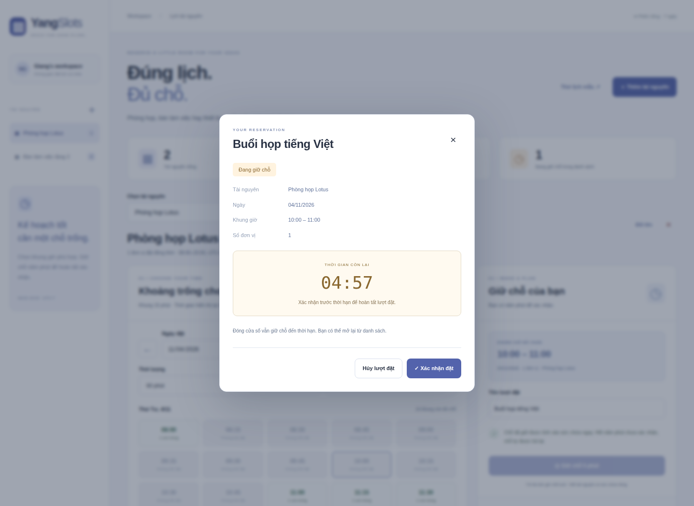

# YangSlots · Đúng lịch. Đủ chỗ.

[](https://github.com/nguyenhonggiang2407/DTDD/actions?query=branch%3Ayangslots)

**Chọn tài nguyên → chọn giờ → giữ chỗ năm phút → xác nhận → xuất lịch.**

Ứng dụng thực hành **Java Backend / Full-stack** của **Nguyễn Hồng Giang (Yang)**. Java 17, Spring Boot 4.1.2, Spring JDBC, Bean Validation và H2 dạng tệp. Giao diện JavaScript thuần, tiếng Việt.

> Đây là ứng dụng độc lập trên nhánh **yangslots** của DTDD. Nhánh mặc định chứa YangCareer. Chọn đúng nhánh khi xem/tải mã. Chưa triển khai website công khai.


## Chạy thử

Cần **JDK 17 trở lên**. Maven Wrapper đã có trong mã nguồn.

```sh
git clone --branch yangslots --single-branch https://github.com/nguyenhonggiang2407/DTDD.git yangslots
cd yangslots
./mvnw spring-boot:run
```

Windows:

```bat
mvnw.cmd spring-boot:run
```

Mở **http://127.0.0.1:3150**. Chọn **Thử lịch mẫu** để tạo hai tài nguyên và ba lịch đặt giả lập cho ngày mai. Với Phòng họp Lotus, 09:00–10:00 đã đặt; chọn 10:00 để thử giữ chỗ rồi xác nhận.

Hoặc dùng Docker, không cần cài JDK/Maven trên máy:

```sh
docker compose up --build
```

Docker build JAR bằng Maven, chạy bằng user riêng, giới hạn 512 MiB/1 CPU và chỉ công bố cổng trên 127.0.0.1. Named volume giữ H2 khi container khởi động lại.

Đóng gói JAR:

```sh
./mvnw clean package
java -jar target/yangslots.jar
```

CI cũng lưu JAR trong artifact **yangslots-application** của lần chạy đã đạt.

## Các luồng đã triển khai

- **Tài nguyên:** tên và sức chứa 1–20 đơn vị, tối đa 10 tài nguyên/workspace. Sức chứa cố định sau khi tạo. Đổi tên/xóa có kiểm tra version; xóa cascade các lượt đặt.
- **Lịch theo ngày:** chọn tài nguyên, ngày, thời lượng và số đơn vị; xem các giờ bắt đầu theo bước 15 phút. Hiển thị tại Việt Nam, UTC+7; API lưu thời điểm chuẩn UTC.
- **Giữ chỗ năm phút:** giữ chỗ chiếm sức chứa ngay. Xác nhận trước hạn chuyển thành CONFIRMED; hết hạn được hiển thị EXPIRED và tự ngừng chiếm chỗ khi đọc/tạo yêu cầu tiếp theo.
- **Không cần tác vụ nền để trả chỗ:** tính hiệu lực bằng clock và hold_until trong truy vấn, kể cả sau khi khởi động lại.
- **Kiểm soát đồng thời:** transaction READ_COMMITTED khóa hàng workspace trước mọi mutation, rồi kiểm tra sức chứa và ghi reservation/idempotency cùng transaction. Các workspace khác có hàng khóa riêng.
- **Đếm đúng các khoảng giao nhau:** thuật toán sweep tìm mức sử dụng cao nhất trong khoảng yêu cầu, thay vì cộng mọi lịch có giao nhau. Khoảng [start,end) cho phép các lượt liền kề.
- **Idempotency:** cùng mã yêu cầu và cùng ý định trả lại đúng reservation cũ. Nội dung khác cùng mã trả 409; xóa tài nguyên giữ tombstone để replay không tạo lại reservation đã xóa.
- **Phục hồi mất phản hồi:** giữ nguyên mã yêu cầu khi chưa nhận được kết quả; nút Nhận lại kết quả lấy lại lượt cũ. Không tạo thêm lượt giữ chỗ cho cùng ý định.
- **Xác nhận/hủy:** dùng version của bản ghi. Khi có tab khác thay đổi, giao diện tải lại trạng thái mới thay cho việc lặp mutation với dữ liệu cũ.
- **Xuất dữ liệu:** CSV theo bộ lọc, bảo vệ chuỗi công thức; ICS chỉ gồm lịch đã xác nhận, UID ổn định, thời gian UTC, escape và fold dòng UTF-8 theo giới hạn 75 octet.
- **Không gian riêng:** cookie HttpOnly/SameSite=Strict, hash token phiên trong DB, CSRF/Origin/Host guards, body limit, UTF-8 strict, CSP và static allowlist.

Bộ mẫu được tạo qua cùng service/transaction với dữ liệu bình thường. Mỗi ngày nhập lại không nhân đôi; sang ngày mới tạo lịch mẫu cho ngày mai.

## Vì sao kiểm tra sức chứa cần sweep?

Ví dụ tài nguyên có hai đơn vị: lượt A dùng một đơn vị 08:00–09:00, lượt B dùng một đơn vị 10:00–11:00. Một yêu cầu mới dùng một đơn vị 08:00–11:00 vẫn hợp lệ: ở mọi thời điểm tổng dùng tối đa hai.

Thuật toán gom điểm bắt đầu/kết thúc, cắt theo khoảng yêu cầu rồi tìm peak. Các mốc cùng thời điểm được cộng dồn một lần để lượt kết thúc không chặn lượt bắt đầu liền sau. Tạo giữ chỗ luôn kiểm tra lại trong transaction; dữ liệu lịch hiển thị chỉ là snapshot.

## Trạng thái và mã yêu cầu

| Trạng thái | Chiếm sức chứa              | Có thể làm tiếp   |
| ---------- | --------------------------- | ----------------- |
| HELD       | Có, khi hold_until còn hạn  | Xác nhận hoặc hủy |
| CONFIRMED  | Có, trong khoảng giờ đã đặt | Hủy               |
| EXPIRED    | Không                       | Chọn một lượt mới |
| CANCELLED  | Không                       | Chọn một lượt mới |

EXPIRED là trạng thái hiệu lực của một hold đã quá hạn; không cần ghi cập nhật bởi scheduler. Replay hold hết hạn/đã hủy trả lại lịch sử cũ và không khôi phục chỗ.

Digest của ý định dùng resource ID, start/end chuẩn UTC, số đơn vị và tiêu đề đã trim/NFC. Từ chối ký tự điều khiển và surrogate Unicode không hợp lệ. Key chỉ được ghi khi transaction tạo hold thành công; xung đột sức chứa hoặc lỗi khác không tiêu thụ key.

Khóa hàng workspace giúp bảo toàn quota và idempotency kể cả khi các request tạo trên hai tài nguyên khác nhau. Thiết kế này tuần tự hóa mutation trong một workspace nhỏ; không phải cam kết thông lượng hay kiến trúc đặt vé nhiều người dùng.

## Thời gian và giới hạn

| Mục         | Quy tắc                                                |
| ----------- | ------------------------------------------------------ |
| Khung giờ   | 08:00–20:00 trong cùng ngày tại Asia/Ho_Chi_Minh       |
| Bước giờ    | 15 phút; từ 15 đến 240 phút mỗi lượt                   |
| Ngày        | Hôm nay đến 90 ngày tiếp theo                          |
| Giờ bắt đầu | Cách server clock ít nhất một phút                     |
| Giữ chỗ     | Năm phút, hết hạn chính xác tại hold_until             |
| Workspace   | Phiên cố định bảy ngày; 10 tài nguyên                  |
| Lịch sử     | Tối đa 100 reservation đang tồn tại                    |
| Mã yêu cầu  | Tối đa 200 key, gồm tombstone; replay cũ vẫn dùng được |
| Request     | JSON UTF-8 tối đa 256 KiB, không nhận body nén         |

Sức chứa là số đơn vị có thể được đặt đồng thời. Phòng riêng nên đặt một đơn vị; một nhóm bàn có thể có nhiều đơn vị. Mỗi lịch cần số đơn vị nguyên dương và không vượt sức chứa.

## Dữ liệu và cấu hình

H2 lưu tại data/yangslots.mv.db theo mặc định. Không có H2 web console hay máy chủ DB TCP. Dữ liệu và token/cookie không được commit; file DB không được phục vụ tĩnh.

| Biến                    | Mặc định                                 |
| ----------------------- | ---------------------------------------- |
| PORT                    | 3150                                     |
| YANGSLOTS_BIND          | 127.0.0.1; container dùng 0.0.0.0        |
| YANGSLOTS_DB            | JDBC H2 URL trong application.properties |
| YANGSLOTS_ALLOWED_HOSTS | localhost,127.0.0.1                      |
| YANGSLOTS_PUBLIC_ORIGIN | scheme + Host của request                |
| YANGSLOTS_SECURE_COOKIE | false; đặt true khi chạy HTTPS           |

Đặt sau proxy cần khai báo host/origin chính xác, dùng HTTPS và bật cookie Secure. Mặc định dành cho máy cá nhân.

Cookie bị xóa hoặc hết bảy ngày sẽ mất khả năng truy cập workspace cũ. Dọn phiên khi khởi động, tạo workspace hoặc gặp cookie hết hạn; cascade xóa dữ liệu liên quan. Xuất lịch trước khi cần lưu lâu dài. File H2 không mã hóa tại ổ đĩa. Ứng dụng chưa có đăng nhập tài khoản, nhắc lịch, thanh toán hay đồng bộ hai chiều với dịch vụ lịch.

H2 ở chế độ tệp cho một tiến trình Java, nhiều connection/request đồng thời. Chưa kiểm thử PostgreSQL, triển khai nhiều instance hay tải sản xuất. API lịch này không đặt phòng/khách sạn trên dịch vụ bên ngoài.

## API

GET /api/workspace cấp cookie, CSRF, ngày máy chủ và giới hạn. Mọi mutation cần X-CSRF-Token và JSON body; tạo hold cần thêm Idempotency-Key từ 8–80 ký tự chữ/số/_/-.

| Endpoint                                               | Hành vi                      |
| ------------------------------------------------------ | ---------------------------- |
| GET /health                                            | Kiểm tra kết nối H2          |
| GET /api/workspace                                     | Bootstrap phiên riêng        |
| GET/POST /api/resources                                | Danh sách / tạo tài nguyên   |
| PATCH/DELETE /api/resources/:id                        | Đổi tên / xóa, cần version   |
| GET /api/availability?resourceId=&day=&minutes=&units= | Snapshot giờ còn chỗ         |
| GET /api/reservations?resourceId=&day=&status=&q=      | Danh sách theo bộ lọc        |
| GET /api/reservations/:id                              | Lượt đặt của workspace       |
| POST /api/holds                                        | Tạo/replay hold              |
| POST /api/reservations/:id/confirm                     | version → xác nhận           |
| POST /api/reservations/:id/cancel                      | version → hủy                |
| GET /api/export.csv                                    | CSV theo bộ lọc              |
| GET /api/calendar.ics                                  | ICS của các lượt đã xác nhận |
| POST /api/demo                                         | Nhập bộ mẫu giả lập          |

Body tạo hold:

```json
{
  "resourceId": "UUID_FROM_RESOURCE",
  "title": "Trao đổi nhóm",
  "startsAt": "2030-01-02T09:00:00+07:00",
  "endsAt": "2030-01-02T10:00:00+07:00",
  "units": 1
}
```

Ngày ví dụ chỉ minh họa định dạng; thay bằng ngày hợp lệ trong 90 ngày tới.

| HTTP      | Hành vi                                                           |
| --------- | ----------------------------------------------------------------- |
| 201 / 200 | Hold mới / replay, trả reservation + replayed                     |
| 400       | Dữ liệu/khung thời gian không hợp lệ                              |
| 401 / 403 | Thiếu phiên / CSRF hoặc Origin không hợp lệ                       |
| 404       | Bản ghi không thuộc workspace hoặc không tồn tại                  |
| 409       | Không đủ chỗ, version cũ, key khác nội dung hoặc quota            |
| 410       | Hold hết hạn khi xác nhận/hủy, hoặc replay của reservation đã xóa |
| 413 / 415 | Body quá lớn / sai content type hoặc encoding                     |

## Kiểm thử

```sh
./mvnw verify
npm ci
npx playwright install --with-deps chromium
npm run test:ui
npm run format:check
```

- Domain: peak theo khoảng, ranh giới liền kề, offset/mốc 15 phút, business hours, thời hạn, Unicode, CSV và ICS.
- Spring/H2/HTTP: 20 request đồng thời tranh bốn chỗ; nhiều request cùng key; giữ chỗ quá hạn; replay/xung đột; private scope; CSRF/Origin/Host; quota/rollback; cascade/tombstone; demo qua ngày.
- Persistence: đóng rồi mở lại Spring context với H2 dạng tệp, giữ đúng cookie/session, resource, reservation và mã replay.
- Browser: giữ→xác nhận→xuất, hủy/đổi tên/xóa, mất response và replay, HTML literal/formula CSV, trạng thái cũ ở tab khác và màn hình 390 px.

CI dùng JDK 17 và Node.js 24, build JAR, chạy các bộ test, chụp giao diện thật, build/run container rồi kiểm tra cả /health và Java health probe. Chỉ khi đạt mới lưu ảnh vào nhánh. Maven Wrapper và workflow không bị bot tự sửa.



<details><summary>Giao diện điện thoại</summary>


</details>

## Cấu trúc

| Thành phần              | Trách nhiệm                                                            |
| ----------------------- | ---------------------------------------------------------------------- |
| RequestGuard + Sessions | Private cookie, CSRF/Origin/Host, body/UTF-8 và thời hạn phiên         |
| Contracts + Rules       | Bean Validation, quy tắc domain, thời gian và sweep                    |
| BookingService          | JDBC, transaction/row lock, quota, idempotency và vòng đời reservation |
| ApiController + Errors  | REST, static allowlist, response/errors và download                    |
| Exports                 | CSV và ICS UTF-8                                                       |
| schema.sql              | Foreign keys, constraints, index và idempotency tombstone              |
| public/                 | Giao diện lịch và luồng giữ chỗ/xác nhận                               |
| src/test/ + test/       | Backend/persistence và browser                                         |
| HealthProbe             | Health check bằng JDK, dùng trong container                            |

## Nguồn và giấy phép

Tham khảo [hotel-booking-crew/kayak.py](https://github.com/Trinhvhao/ai-engineering-hub/blob/86dc1699fe036e5cd21ed7d3c57419a7fc3c844b/hotel-booking-crew/kayak.py), trong fork của Trinhvhao, dự án gốc [patchy631/ai-engineering-hub](https://github.com/patchy631/ai-engineering-hub). Mã này tạo URL tìm khách sạn theo địa điểm/ngày/số khách; bản gốc được giữ tại upstream/hotel_search.py cùng MIT gốc.

YangSlots mới triển khai phần giữ chỗ, sức chứa, private sessions, transaction, export và UI. Không nhận là tác giả mã tham khảo hay toàn bộ dự án CrewAI. Phân định tại [NOTICE.md](NOTICE.md).

Maven Wrapper do Spring Initializr sinh, giữ Apache-2.0/NOTICE trong LICENSES/. Các dependency giữ giấy phép riêng. [Tài liệu Spring Boot](https://docs.spring.io/spring-boot/system-requirements.html).

Implementation © 2026 Nguyễn Hồng Giang · Upstream © 2024 patchy631 · MIT.
