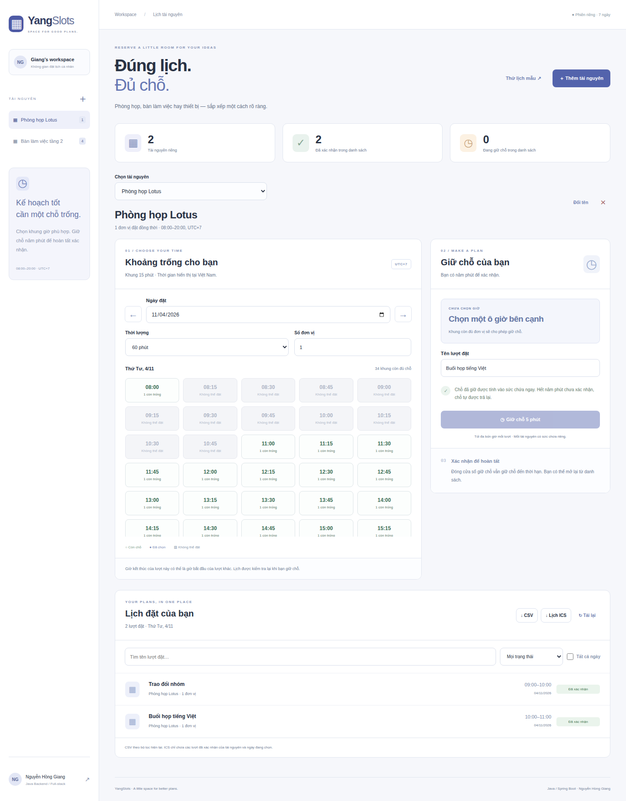
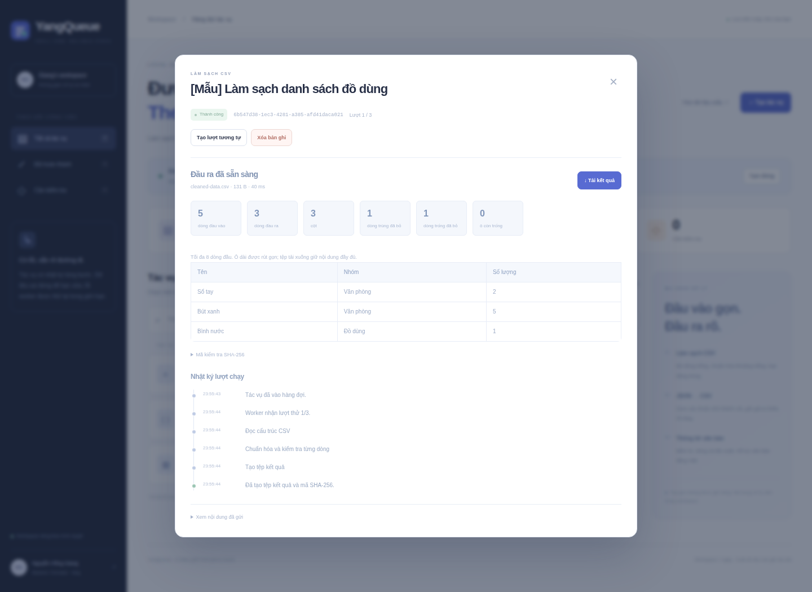
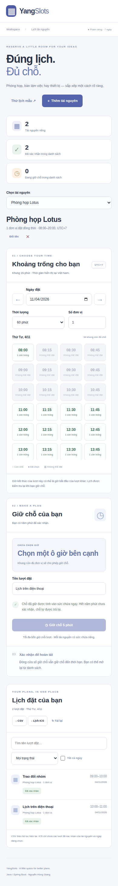

# YangQueue

**Đưa việc vào hàng đợi. Theo dõi đến kết quả.**

Node.js 24 · SQLite WAL · Worker Threads · Không có dependency runtime bên ngoài

[Chạy thử](#chạy-thử) · [Cơ chế hàng đợi](#cơ-chế-hàng-đợi) · [Kiểm thử](#kiểm-thử) · [Ghi nguồn](NOTICE.md)

YangQueue xử lý CSV, JSON và văn bản bằng worker nền, giữ trạng thái và nhật ký
trong SQLite. Mỗi trình duyệt có workspace riêng. Đây là dự án backend một
node dành cho học tập và sử dụng cá nhân, phát triển cho **Nguyễn Hồng Giang**.

Mã hiện nằm ở nhánh **yangqueue** của repo DTDD.

## Chạy thử

Cần Node.js 24 trở lên.

~~~bash
git clone --branch yangqueue --single-branch https://github.com/nguyenhonggiang2407/DTDD.git YangQueue
cd YangQueue
npm ci
npm start
~~~

Mở <http://127.0.0.1:3120>. Chọn **Thử dữ liệu mẫu**, rồi **Tiếp tục** để chạy
ba tác vụ bằng worker thật. Bộ mẫu đầu tiên được nạp ở trạng thái tạm dừng để
bạn có thể quan sát hàng đợi trước khi xử lý.

Chỉ chạy ứng dụng:

~~~bash
npm ci --omit=dev
npm start
~~~

Hoặc:

~~~bash
docker compose up --build
~~~

Compose bind cổng vào loopback, lưu SQLite trong named volume và giới hạn
tài nguyên container. CI có bước build image và gọi health check từ container.

## Các tác vụ

| Kiểu | Xử lý | Kết quả |
|---|---|---|
| csv-clean | Đọc CSV có quoted comma, CRLF, ô nhiều dòng; tùy chọn trim và loại dòng trùng; bỏ dòng trống | CSV UTF-8 BOM, báo cáo số dòng/ô và preview |
| json-csv | Chuyển mảng object sang bảng theo hợp các thuộc tính; giá trị lồng nhau được stringify | CSV và báo cáo cột/dòng |
| text-stats | Đếm token chữ/số, dòng, ký tự và 10 từ xuất hiện nhiều nhất, giữ dấu tiếng Việt | Báo cáo Markdown |

Mỗi tác vụ nhận tối đa **256 KB** nội dung. CSV/JSON tối đa **5.000 dòng, 30 cột**;
JSON sâu tối đa 8 mức; văn bản tối đa 20.000 từ. Đầu ra tối đa 1 MB.
Preview hiển thị 8 dòng đầu và rút gọn các ô dài; file tải xuống giữ nội dung đầy đủ.

CSV escape các ô chuỗi bắt đầu bằng ký tự có thể được bảng tính hiểu là công
thức. Các số JSON thực được giữ là giá trị số. Thống kê văn bản là đếm token,
không phải tóm tắt hoặc suy luận bằng mô hình. Không có gọi API bên ngoài,
crawl web, gửi bài hay lưu khóa API.

## Cơ chế hàng đợi

~~~mermaid
stateDiagram-v2
    direction TB
    [*] --> queued
    queued --> running: claim trong giao dịch
    running --> succeeded: kiểm tra đầu ra và checksum
    running --> retry_wait: lỗi tạm thời, còn lượt
    retry_wait --> running: đến thời điểm thử lại
    running --> failed: dữ liệu sai hoặc hết lượt
    queued --> cancelled: người dùng hủy
    retry_wait --> cancelled: người dùng hủy
    running --> cancelled: thu hồi claim và dừng worker
~~~

- Mỗi lượt claim có token và lease 10 giây. Heartbeat mỗi giây chỉ gia hạn claim
  còn hiệu lực. Worker cũ không thể ghi đè kết quả sau khi lease mất hoặc bị hủy.
- Tối đa 2 worker trong process, tối đa 1 tác vụ đang chạy cho mỗi workspace.
  Các tác vụ đủ điều kiện được chọn theo thứ tự tạo.
- Timeout mặc định 5 giây/lượt. Lỗi worker được thử tối đa 3 lần với backoff
  tăng dần. Lỗi định dạng dữ liệu dừng ngay để người dùng sửa.
- Khởi động lại sẽ thu hồi lease đã hết hạn. Shutdown có kiểm soát trả công
  việc chưa hoàn tất về trạng thái chờ thử lại.
- Idempotency-Key được ràng buộc với owner và hash payload. Cùng key/cùng
  payload trả tác vụ cũ; cùng key/khác payload trả 409. Xóa tác vụ vẫn giữ
  tombstone của key cho đến khi workspace hết hạn, tránh chạy lại ngoài ý muốn.
- Hủy và xóa cần version hiện tại. Lượt chạy lại thủ công tạo job con, giữ
  nguyên attempts và lỗi của lượt cũ.
- Đầu ra được kiểm tra tên file, MIME, kích thước và SHA-256 trước khi lưu.
  Không dùng tên file người gửi làm đường dẫn máy chủ.

Đây là xử lý **at-least-once** với kết quả được bảo vệ bằng claim token,
không phải cam kết exactly-once hoặc một hàng đợi phân tán đa máy.

## API

GET /api/workspace trả cookie HttpOnly/SameSite=Strict và token csrf.
Gửi X-CSRF-Token cho các thao tác ghi. Mọi API dữ liệu đều kiểm tra workspace.

| Phương thức | Endpoint | Chức năng |
|---|---|---|
| GET | /api/queue?q=...&state=... | Danh sách, thống kê và trạng thái tạm dừng của workspace |
| POST | /api/jobs | Tạo job; cần Idempotency-Key |
| GET | /api/jobs/{id} | Job, input, kết quả và nhật ký thuộc workspace |
| POST | /api/jobs/{id}/cancel | Hủy với version |
| POST | /api/jobs/{id}/retry | Tạo lượt chạy con với version và key mới |
| DELETE | /api/jobs/{id} | Xóa tác vụ đã kết thúc với version |
| GET | /api/jobs/{id}/download | Tải file sau khi thành công |
| POST | /api/queue/pause | paused: true hoặc false |
| POST | /api/demo | Nạp dữ liệu giả lập, không nhân bản |
| GET | /health | Kiểm tra HTTP và kết nối SQLite |

Ví dụ payload tạo job:

~~~json
{
  "title": "Làm sạch danh sách",
  "type": "csv-clean",
  "input": "name\nA\nA\n",
  "options": { "trim": true, "dedupe": true }
}
~~~

Response nhận việc có requestId, status và job. HTTP 201 là tạo mới, 200 là
replay. Các lỗi nghiệp vụ dùng 400/401/403/404/409/410/413/415 theo ngữ cảnh.
Request JSON không nén tối đa 768 KB, kể cả khi không gửi Content-Length.

## Tổ chức mã

| Tệp | Vai trò |
|---|---|
| server.mjs | HTTP, session, CSRF/Origin/Host, API và static allowlist |
| lib/store.mjs | SQLite, idempotency, claim lease, version, trạng thái và events |
| lib/queue.mjs | Pool worker, timeout, heartbeat, hủy và shutdown |
| lib/processors.mjs | Parser CSV và các phép biến đổi giới hạn tài nguyên |
| lib/processor-worker.mjs | Chạy phép xử lý trong Worker Thread |
| public | Dashboard, nhập tệp UTF-8, preview, download và nhật ký |
| test | Kiểm thử domain, store, worker, HTTP và browser |
| upstream | Mã MIT gốc để tham chiếu, không chạy trong runtime |

## Kiểm thử

~~~bash
npm ci
npm test
npx playwright install --with-deps chromium
npm run test:ui
~~~

Kiểm tra gồm CSV quotes/newline và ô công thức, JSON shape/depth/prototype-like
keys, thống kê Unicode, idempotency và tombstone, FIFO theo workspace, pause,
retry/backoff/exhaustion, stale cancel, heartbeat, hard restart bằng DB file,
worker thật, timeout, late result, shutdown, API ownership, Host/CSRF/Origin,
giới hạn streaming và UTF-8 lỗi.

Browser tests dùng worker thật để xử lý dữ liệu, tải CSV và đối chiếu SHA-256,
hủy/xóa, sửa dữ liệu sai thành lượt mới, upload UTF-8, render HTML thành text
và kiểm tra layout 390 px. CI kiểm thử rồi lưu ảnh giao diện thật trong repo.

Xem kết quả và giao diện mobile

## Cấu hình và phạm vi

| Biến | Mặc định |
|---|---|
| PORT | 3120 |
| YANGQUEUE_BIND | 127.0.0.1 |
| YANGQUEUE_DB | data/yangqueue.sqlite |
| YANGQUEUE_ALLOWED_HOSTS | localhost,127.0.0.1 |
| YANGQUEUE_PUBLIC_ORIGIN | HTTP origin của request |
| YANGQUEUE_SECURE_COOKIE | 0; đặt 1 khi dùng HTTPS |

Workspace có thời hạn 7 ngày, tối đa 50 tác vụ và 10 tác vụ chưa kết thúc.
Đây không phải đăng nhập tài khoản; xóa cookie làm mất quyền truy cập workspace
cũ. Dữ liệu hết hạn được dọn khi tạo workspace mới. Xuất dữ liệu cần giữ lâu dài.

Tạm dừng chỉ ngăn claim mới; tác vụ đã nhận vẫn tiếp tục. Polling UI dừng khi
tab ẩn và cập nhật lại khi bạn quay lại. Dữ liệu mẫu là giả lập.

Bản hiện tại dùng một Node process và SQLite, chưa kiểm thử tải lớn. Trước khi
phục vụ internet cần thêm đăng nhập, rate limit, TLS, backup và lịch dọn dữ
liệu. Không có scheduler theo lịch, webhook ngoài hoặc xử lý side effect bên ngoài.

## Nguồn gốc

Phát triển cho **[Nguyễn Hồng Giang](https://github.com/nguyenhonggiang2407)**.
Xuất phát từ giao diện nhận yêu cầu và luồng event-step trong ví dụ
motia-content-creation (MIT), tiếp cận qua Trinhvhao, tác giả gốc patchy631.
Queue engine, lưu trữ, worker và UI được viết mới. Xem [NOTICE.md](NOTICE.md)
để phân biệt rõ phần tham khảo và phần mới; giữ [LICENSE](LICENSE) gốc.
