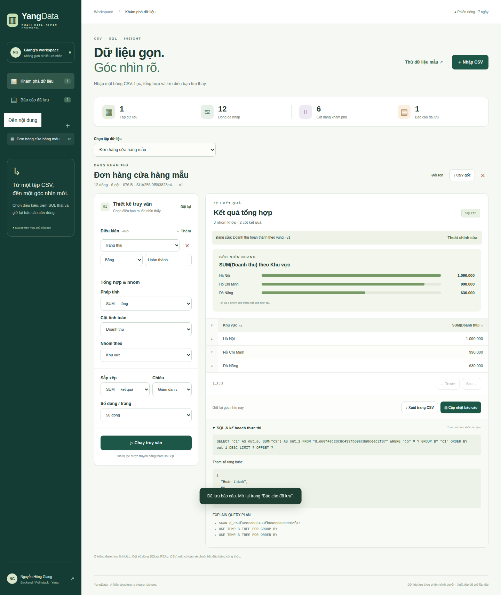
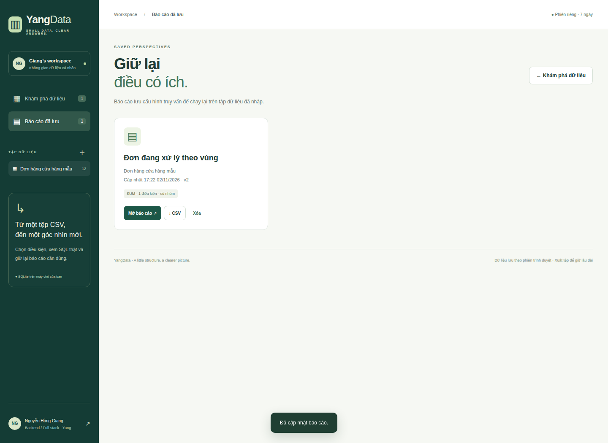

# YangData · Small data, clear answers

[](https://github.com/nguyenhonggiang2407/DTDD/actions?query=branch%3Ayangdata)

**Nhập CSV → đặt điều kiện → xem SQL thật → lưu báo cáo → xuất kết quả.**

Ứng dụng thực hành Backend / Full-stack của **Nguyễn Hồng Giang (Yang)**. Node.js 24, SQLite và JavaScript thuần; không cần API key hay dịch vụ mô hình.

> Nhánh **yangdata** chứa một ứng dụng độc lập. Nhánh mặc định của DTDD là YangCareer; chọn đúng nhánh khi tải hoặc xem mã. Ứng dụng chưa được triển khai thành website công khai.


## Chạy thử

```sh
git clone --branch yangdata --single-branch https://github.com/nguyenhonggiang2407/DTDD.git yangdata
cd yangdata
npm ci
npm start
```

Mở **http://127.0.0.1:3130**. Chọn **Thử dữ liệu mẫu** để nhập 12 đơn hàng giả lập. Thử lọc Trạng thái = Hoàn thành, SUM Doanh thu, nhóm theo Khu vực và sắp xếp giảm dần. Kết quả là Hà Nội 1.090.000, Hồ Chí Minh 990.000 và Đà Nẵng 630.000.

Hoặc dùng container:

```sh
docker compose up --build
```

Cổng chỉ được công bố trên 127.0.0.1. Named volume giữ SQLite khi container khởi động lại. Container chạy bằng user node và có health check.

## Các luồng đã triển khai

- **Nhập & xem trước:** đọc CSV UTF-8, BOM, CRLF, dấu ngoặc kép và xuống dòng trong ô. Chuẩn hóa NFC, trim giá trị và bỏ dòng trống. Xem trước năm dòng, chọn TEXT/REAL trước khi lưu.
- **Kiểu dữ liệu rõ ràng:** mã 001 và 1e3 giữ TEXT; số thập phân thường có thể suy luận REAL. Ô trống thành NULL. Cột không có giá trị giữ TEXT. Không tự suy luận ngày tháng.
- **Truy vấn có giới hạn:** chọn cột, tối đa tám điều kiện AND; bằng/khác, so sánh số, chuỗi chứa/bắt đầu, IS NULL/IS NOT NULL. COUNT, SUM, AVG, MIN, MAX, nhóm và sắp xếp kết quả; phân trang tối đa 500 dòng.
- **SQL có thể kiểm tra:** hiển thị câu SELECT, mảng tham số ràng buộc và EXPLAIN QUERY PLAN thực tế từ SQLite. Dữ liệu lọc luôn được bind; tên bảng/cột chỉ lấy từ định danh do máy chủ cấp.
- **Báo cáo:** lưu cấu hình của lần chạy thành công, mở và chạy lại, cập nhật có phiên bản hoặc lưu thành bản mới. Cấu hình thay đổi phải chạy lại trước khi lưu/xuất; báo cáo mở từ trang đầu.
- **Vòng đời dữ liệu:** nhận diện bản nhập trùng theo SHA256 của dữ liệu/kiểu đã chuẩn hóa trong từng workspace. Đổi tên có kiểm tra phiên bản; xóa tập dữ liệu sẽ xóa cả bảng vật lý và báo cáo liên quan trong một transaction.
- **Xuất CSV:** trang kết quả hiện tại hoặc toàn bộ tập dữ liệu, UTF-8 BOM, escape dấu ngoặc kép và bảo vệ chuỗi mở đầu bằng dấu công thức. Số âm vẫn là số.
- **Không gian riêng:** cookie HttpOnly, SameSite=Strict; token phiên chỉ lưu dạng hash trong DB; CSRF, Origin/Host allowlist, CSP, static allowlist và kiểm tra quyền sở hữu trên mọi thao tác dữ liệu/báo cáo.

Không gửi dữ liệu tới API bên ngoài. Source Python trong upstream/ chỉ là tài liệu tham chiếu, không chạy trong ứng dụng. Giao diện không nhận câu SQL tự do và không dùng LLM để tạo SQL.

## Giới hạn & hành vi dữ liệu

| Mục           | Giới hạn / hành vi                                                               |
| ------------- | -------------------------------------------------------------------------------- |
| CSV           | 512 KiB, 5.000 dòng dữ liệu, 30 cột, 2.000 ký tự mỗi ô                           |
| HTTP JSON     | 1 MiB, UTF-8 hợp lệ; không nhận body nén                                         |
| Workspace     | 5 tập dữ liệu, 20 báo cáo, phiên cố định 7 ngày                                  |
| Truy vấn      | 8 điều kiện AND, 1–500 dòng/trang, offset 0–5.000                                |
| Số            | SQLite REAL: số thực gần đúng; không dùng cho kế toán cần độ chính xác tuyệt đối |
| So sánh chuỗi | NFC, so sánh theo SQLite; LIKE mặc định chỉ không phân biệt hoa/thường ASCII     |
| NULL          | Ô trống và chuỗi chỉ gồm khoảng trắng được lưu NULL; lọc NULL bằng toán tử riêng |
| CSV xuất      | NULL thành ô trống; chuỗi có dấu công thức được thêm dấu nháy đơn                |
| Dọn dữ liệu   | Dọn phiên hết hạn khi khởi động, tạo workspace hoặc gặp cookie đã hết hạn        |

Không hỗ trợ sửa từng ô, JOIN, OR, SQL tự do, truy vấn ngôn ngữ tự nhiên hay chia sẻ dữ liệu công khai. Các tập dữ liệu chỉ có chỉ mục khóa dòng; EXPLAIN có thể hiển thị quét bảng hoặc B-tree tạm khi tổng hợp/sắp xếp. Mỗi phép nhập/query được giới hạn bởi các quota trên.

Phiên gắn với cookie trình duyệt. Xóa cookie hoặc hết bảy ngày sẽ mất khả năng truy cập workspace cũ; hãy xuất CSV trước nếu muốn lưu lâu dài. Đây là ứng dụng phục vụ thực hành cá nhân, chưa có tài khoản người dùng hay khôi phục phiên. Mặc định chỉ bind localhost.

## Cấu hình máy chủ

| Biến                   | Mặc định                                                 |
| ---------------------- | -------------------------------------------------------- |
| PORT                   | 3130                                                     |
| YANGDATA_BIND          | 127.0.0.1; container dùng 0.0.0.0                        |
| YANGDATA_DB            | data/yangdata.sqlite                                     |
| YANGDATA_ALLOWED_HOSTS | localhost,127.0.0.1                                      |
| YANGDATA_PUBLIC_ORIGIN | http:// + Host, hoặc origin HTTPS thật khi đặt sau proxy |
| YANGDATA_SECURE_COOKIE | 0; đặt 1 khi chạy HTTPS                                  |

Khi đặt sau reverse proxy, khai báo chính xác host và origin, bật cookie Secure và chỉ mở qua HTTPS. Không đưa thư mục data/ vào máy chủ tệp tĩnh. Cơ sở dữ liệu chứa CSV đã nhập ở dạng đọc được; không có mã hóa dữ liệu tại ổ đĩa.

## Kiến trúc

| Thành phần                     | Trách nhiệm                                                                     |
| ------------------------------ | ------------------------------------------------------------------------------- |
| server.mjs                     | HTTP, phiên, CSRF/Origin/Host, body limit, static allowlist, API và downloads   |
| lib/datasets.mjs + lib/csv.mjs | Parse, validate, infer/override kiểu, checksum và CSV export                    |
| lib/query.mjs                  | Biên dịch grammar được phép thành SELECT + bind parameters                      |
| lib/store.mjs                  | SQLite, bảng riêng từng dataset, owner scope, transaction và optimistic version |
| public/                        | Giao diện tiếng Việt, DOM textContent, builder, bảng kết quả và báo cáo         |
| test/                          | Kiểm thử dữ liệu, SQL injection, vòng đời, HTTP và luồng trình duyệt            |
| upstream/                      | Mã tham chiếu MIT được giữ nguyên; không thực thi                               |

SQLite dùng WAL, foreign keys và busy timeout. Nhập dữ liệu, tạo bảng/metadata cùng transaction; xóa dữ liệu và dọn phiên cũng drop bảng vật lý cùng cascade metadata. Phiên và quyền sở hữu được kiểm tra trước khi biên dịch bất cứ truy vấn nào.

## API

Tất cả API dữ liệu cần cookie từ GET /api/workspace. Mọi POST/PATCH/PUT/DELETE cần X-CSRF-Token và Origin hợp lệ nếu gửi Origin. Không có endpoint chạy SQL tùy ý.

| Endpoint                           | Hành vi                                              |
| ---------------------------------- | ---------------------------------------------------- |
| GET /health                        | Kiểm tra tiến trình và kết nối SQLite                |
| GET /api/workspace                 | Bootstrap phiên riêng, CSRF và giới hạn              |
| POST /api/inspect                  | Kiểm tra CSV, xem schema và năm dòng; không lưu      |
| GET /api/datasets?q=               | Danh sách của workspace; tìm tên không dấu           |
| POST /api/datasets                 | Nhập; 201 mới, 200 nếu nội dung đã tồn tại           |
| GET/PATCH/DELETE /api/datasets/:id | Xem / đổi tên / xóa; mutation cần version            |
| GET /api/datasets/:id/export       | Xuất toàn bộ dữ liệu thuộc workspace                 |
| POST /api/query                    | Chạy grammar truy vấn được giới hạn                  |
| POST /api/query/export             | Xuất đúng trang của truy vấn                         |
| GET/POST /api/reports              | Danh sách / tạo báo cáo                              |
| GET/PUT/DELETE /api/reports/:id    | Xem / cập nhật / xóa; update/delete cần version      |
| POST /api/reports/:id/run          | Chạy cấu hình đã lưu                                 |
| POST /api/reports/:id/export       | Xuất trang đầu theo cấu hình đã lưu                  |
| POST /api/demo                     | Nhập bộ mẫu trong workspace; nhập lại không nhân đôi |

Ví dụ body query; thay datasetId bằng ID do API cấp:

```json
{
  "datasetId": "ID_FROM_IMPORT",
  "filters": [{ "column": "c5", "op": "eq", "value": "Hoàn thành" }],
  "groupBy": "c1",
  "aggregate": { "fn": "sum", "column": "c3" },
  "orderBy": "value",
  "direction": "desc",
  "limit": 50,
  "offset": 0
}
```

## Kiểm thử

```sh
npm test
npx playwright install --with-deps chromium
npm run test:ui
npm run format:check
```

CI cài dependency theo lockfile, định dạng mã, chạy bộ test backend và browser, chụp giao diện thật, build image rồi chạy container để kiểm tra /health. Khi tất cả thành công, bot lưu mã đã định dạng và ảnh chụp vào nhánh này. Workflow không được bot tự sửa.

Các ca kiểm tra gồm ID có số 0 đầu, RFC-style quoted CSV, malformed UTF-8/CSV, giới hạn tài nguyên, SQL injection/literal LIKE, NULL, tổng hợp, phân trang, private workspace, quota, optimistic version, báo cáo, cascade/expiry và lưu dữ liệu qua restart. Browser kiểm tra nhập/xem kiểu, literal HTML/XSS, lọc→tổng hợp→lưu→mở→cập nhật→download, cảnh báo CSV lỗi, phân trang/xóa và màn hình 390 px.



<details>
<summary>Báo cáo và giao diện điện thoại</summary>




</details>

## Nguồn và giấy phép

Tham khảo ví dụ [rag-sql-router](https://github.com/Trinhvhao/ai-engineering-hub/tree/86dc1699fe036e5cd21ed7d3c57419a7fc3c844b/rag-sql-router), từ fork của Trinhvhao; dự án gốc là [patchy631/ai-engineering-hub](https://github.com/patchy631/ai-engineering-hub).

Ví dụ upstream dùng công cụ SQL cùng mô hình ngôn ngữ. YangData mới triển khai runtime Node.js, query builder xác định, lưu trữ/quyền truy cập riêng và giao diện; không vận hành pipeline LLM upstream. Mã tham chiếu được giữ nguyên tại upstream/rag_sql_tools.py, cùng MIT gốc trong LICENSE. Phân định phần tham khảo và phần mới tại [NOTICE.md](NOTICE.md).

Implementation © 2026 Nguyễn Hồng Giang · Upstream © 2024 patchy631 · MIT.
