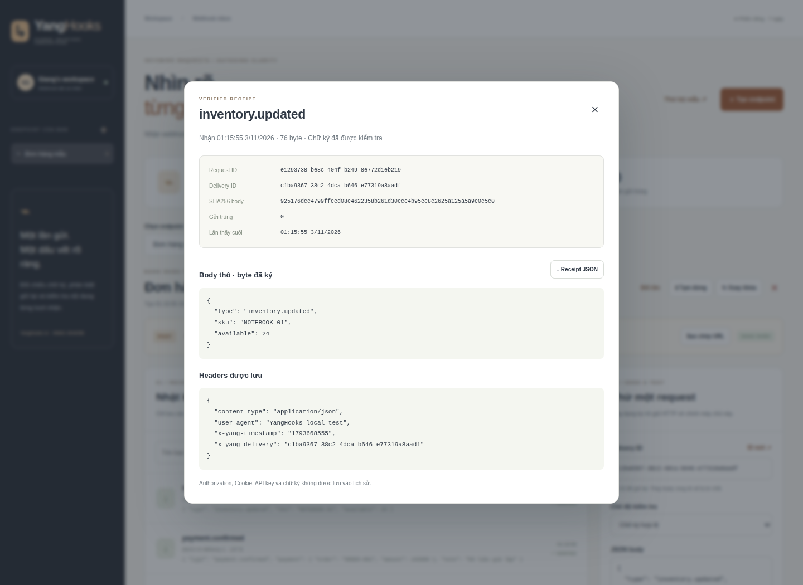

# YangHooks · Signed, received, understood

[](https://github.com/nguyenhonggiang2407/DTDD/actions?query=branch%3Ayanghooks)

**Một webhook lab cá nhân: cấp khóa → ký request → nhận HTTP thật → mở receipt → thử gửi lại.**

Ứng dụng Backend / Full-stack của **Nguyễn Hồng Giang (Yang)**. Node.js 24, SQLite và JavaScript thuần; không có dependency runtime ngoài Node.

Nhánh **yanghooks** là một ứng dụng độc lập trong DTDD. Nhánh mặc định là YangCareer; hãy chọn đúng nhánh. Chưa triển khai website công khai.


## Chạy thử

```sh
git clone --branch yanghooks --single-branch https://github.com/nguyenhonggiang2407/DTDD.git yanghooks
cd yanghooks
npm ci
npm start
```

Mở **http://127.0.0.1:3140**. Chọn **Thử bộ mẫu**: ứng dụng tạo endpoint và gửi hai request có chữ ký qua HTTP loopback thật. Khóa mới chỉ hiện một lần; đóng hộp thoại để xem hộp thư.

Ở trình gửi thử, bấm **Ký & gửi HTTP**. Gửi lại cùng ID/body trả **HTTP 200** và cùng requestId; body khác cùng ID trả **409**. Chọn chữ ký sai hoặc quá hạn để thử **401**; các request bị từ chối không lưu vào lịch sử.

Hoặc:

```sh
docker compose up --build
```

Compose chỉ công bố cổng trên 127.0.0.1, lưu SQLite trong named volume, giới hạn 512 MiB/1 CPU. Image chạy bằng user node và có health check.

## Gửi từ CLI

1. Tạo endpoint và lưu khóa HMAC chỉ hiện một lần.
2. Dùng payload.json có sẵn hoặc một tệp JSON UTF-8 của bạn.
3. Thay URL và khóa bằng giá trị vừa được cấp:

```sh
YANGHOOKS_SECRET='COPY_YOUR_ONE_TIME_KEY' \
node scripts/send.mjs http://127.0.0.1:3140/hooks/ENDPOINT_ID payload.json my-delivery-001
```

CLI chỉ gửi đến localhost/127.0.0.1, không theo redirect và không in khóa vào kết quả. Lệnh cần Node.js trên máy chạy; CLI không được đóng vào runtime container. Đừng commit khóa thật hay tệp .env.

## Các luồng đã triển khai

- **Endpoint riêng:** tối đa năm endpoint trong một phiên trình duyệt, đổi tên, tạm dừng/tiếp tục, xoay khóa và xóa cùng lịch sử. Mutations dùng version để phát hiện xung đột.
- **Receipt thật:** requestId phía máy chủ, delivery ID, loại sự kiện, body thô, số byte, SHA256, thời điểm nhận/lần thấy cuối và bộ đếm gửi trùng.
- **Xác minh trước khi lưu:** HMAC-SHA256 trên timestamp, delivery ID và đúng byte body; so sánh timing-safe, cửa sổ thời gian ±300 giây, giới hạn body/độ sâu JSON.
- **Gửi lại có kiểm soát:** cùng endpoint + delivery ID + body byte trả lại receipt cũ. Cùng ID nhưng body khác bị từ chối. Chữ ký luôn phải hợp lệ kể cả khi nhận trùng.
- **Xoay khóa:** khóa mới được cấp một lần qua mutation; mọi API đọc và export loại khóa khỏi response. Chữ ký khóa cũ mất hiệu lực ngay; receipt cũ được giữ.
- **Trình gửi thử:** ký và gửi về đúng cổng loopback của máy chủ đang chạy; người dùng không thể nhập URL đích khác. Các chế độ chữ ký sai/quá hạn vẫn đi qua route nhận thật.
- **Xem & xuất:** tìm theo loại sự kiện, delivery ID hoặc nội dung, mở body chính xác đã ký, tải một receipt hoặc xuất toàn bộ lịch sử JSON. Chỉ lưu một số header cho phép; loại Authorization, Cookie, API key và chữ ký.
- **Workspace:** cookie HttpOnly/SameSite=Strict, token phiên lưu dạng hash, CSRF/Origin/Host guards cho API quản trị, CSP và static allowlist. Phân quyền owner trên mọi thao tác dữ liệu/cấu hình.

Các request hợp lệ được ghi trong transaction SQLite; ràng buộc UNIQUE(endpoint_id, delivery) ngăn tạo hai receipt cho cùng ID. Version cấu hình không đổi khi nhận dữ liệu nên lượt nhận mới không gây xung đột giả cho nút tạm dừng.

## Giao thức YangHooks v1

Đây là giao thức của lab. Nó **không tương thích trực tiếp** với chữ ký/headers riêng của GitHub, Stripe hay các provider khác.

| Header           | Giá trị                                 |
| ---------------- | --------------------------------------- |
| Content-Type     | application/json                        |
| X-Yang-Timestamp | Unix seconds dạng chuỗi 10 chữ số       |
| X-Yang-Delivery  | 8–100 ký tự A–Z, a–z, 0–9, _ hoặc -     |
| X-Yang-Signature | sha256= + HMAC hex chữ thường, 64 ký tự |

Chuỗi byte được ký:

```text
UTF8(timestamp + "." + deliveryId + ".") + rawBodyBytes
```

Secret là chuỗi UTF-8 64 ký tự hex do máy chủ sinh ngẫu nhiên (32 byte entropy). Body phải là object hoặc array JSON UTF-8. Đừng parse/stringify lại body giữa bước ký và gửi vì khoảng trắng cũng làm thay đổi chữ ký. Đồng bộ đồng hồ của bên gửi/nhận trong cửa sổ năm phút.

| HTTP      | Hành vi                                                  |
| --------- | -------------------------------------------------------- |
| 201       | Nhận mới; trả requestId, status=accepted, replayed=false |
| 200       | Gửi lại cùng ID/body; requestId cũ, replayed=true        |
| 400       | JSON/giá trị không hợp lệ                                |
| 401       | Sai chữ ký, header xác minh hoặc thời gian               |
| 404       | Endpoint không tồn tại hoặc workspace đã hết hạn         |
| 409       | Tạm dừng, ID/body xung đột, quota hoặc version cũ        |
| 413 / 415 | Quá giới hạn body / sai loại nội dung                    |

Phát hiện gửi trùng áp dụng trong vòng đời endpoint; bộ đếm/lần thấy cuối được cập nhật. Không có tự retry, hàng đợi chuyển tiếp hay gửi đến máy chủ ngoài. Request bị từ chối chỉ trả lỗi HTTP; không lưu body đó vào lịch sử.

## Giới hạn và lưu trữ

| Mục          | Giới hạn                                                                                        |
| ------------ | ----------------------------------------------------------------------------------------------- |
| Workspace    | 5 endpoint, thời hạn cố định bảy ngày                                                           |
| Endpoint     | 100 receipt duy nhất; gửi trùng vẫn dùng được khi đầy                                           |
| Webhook body | 64 KiB, object/array JSON, UTF-8 hợp lệ                                                         |
| JSON         | 10 mức lồng, 5.000 giá trị, 1.000 phần tử/object hoặc array, 10.000 ký tự/chuỗi, 200 ký tự/khóa |
| API quản trị | JSON tối đa 256 KiB, không nhận body nén                                                        |
| Máy chủ      | Localhost mặc định, request timeout, max header 16 KiB                                          |

SQLite dùng WAL, foreign keys và busy timeout. Hết hạn phiên sẽ cascade xóa endpoint/receipt khi khởi động, tạo workspace hoặc gặp cookie hết hạn. Các secret/body trong DB **không mã hóa tại ổ đĩa**: đây là công cụ thử nghiệm cục bộ, chưa có đăng nhập nhiều người dùng, kiểm soát tốc độ theo IP hay giới hạn dung lượng toàn máy chủ.

Cookie bị xóa hoặc hết bảy ngày sẽ mất quyền truy cập workspace cũ. Xuất dữ liệu trước nếu muốn giữ lâu dài. Không dùng dữ liệu sản xuất nhạy cảm trong lab. Key chỉ hiện một lần trên giao diện/API tạo/rotate, nhưng vẫn được giữ dạng đọc được trong DB để xác minh HMAC.

## Cấu hình

| Biến                    | Mặc định                      |
| ----------------------- | ----------------------------- |
| PORT                    | 3140                          |
| YANGHOOKS_BIND          | 127.0.0.1; container: 0.0.0.0 |
| YANGHOOKS_DB            | data/yanghooks.sqlite         |
| YANGHOOKS_ALLOWED_HOSTS | localhost,127.0.0.1           |
| YANGHOOKS_PUBLIC_ORIGIN | http:// + Host                |
| YANGHOOKS_SECURE_COOKIE | 0; đặt 1 khi chạy HTTPS       |

Khi đặt sau proxy, khai báo host/origin chính xác, bật cookie Secure và dùng HTTPS. Giữ 127.0.0.1 trong Host allowlist nếu dùng trình gửi thử nội bộ. Thư mục data/ không được phục vụ tĩnh. Chưa cấu hình public hosting trong dự án này.

## API quản trị

Các API dưới cần cookie từ GET /api/workspace. POST/PATCH/DELETE cần X-CSRF-Token. Route /hooks/:id độc lập cookie/CSRF và chỉ xác thực bằng HMAC.

| Endpoint                            | Hành vi                                                    |
| ----------------------------------- | ---------------------------------------------------------- |
| GET /health                         | SQLite health check                                        |
| GET /api/workspace                  | Bootstrap cookie, CSRF và giới hạn                         |
| GET/POST /api/endpoints             | Danh sách / tạo; create trả khóa một lần                   |
| GET/PATCH/DELETE /api/endpoints/:id | Xem / đổi tên hoặc trạng thái / xóa; mutations cần version |
| POST /api/endpoints/:id/rotate      | version → khóa mới một lần                                 |
| GET /api/endpoints/:id/events?q=    | Danh sách và tìm nội dung                                  |
| POST /api/endpoints/:id/send        | Gửi HTTP loopback đã ký; body {raw,deliveryId?,mode?}      |
| GET /api/endpoints/:id/export       | Download toàn bộ receipt JSON; không chứa khóa             |
| GET /api/events/:id                 | Receipt đầy đủ của workspace                               |
| POST /hooks/:id                     | Nhận webhook theo giao thức v1                             |

## Kiểm thử & cấu trúc

```sh
npm test
npx playwright install --with-deps chromium
npm run test:ui
npm run format:check
```

Bộ test bao gồm HMAC so với Node crypto độc lập, byte body, thời gian biên, replay/conflict, JSON bounds, private owner, key rotation, pause, quota, CAS deletion/expiry, SQLite restart và CLI HTTP thực. Browser kiểm tra inbox → gửi HTTP → receipt → download, external signed request, HTML literal/XSS, rotate/old key, lỗi/replay/pause/delete và màn hình 390 px.

CI định dạng mã, chạy backend/browser, chụp giao diện thật, build/run container và gọi /health. Chỉ khi tất cả thành công, bot mới lưu ảnh/mã đã định dạng; bot không tự sửa workflow.

| Đường dẫn                 | Trách nhiệm                                                        |
| ------------------------- | ------------------------------------------------------------------ |
| server.mjs + lib/http.mjs | HTTP, raw body bounds, private admin API và loopback sender        |
| lib/signature.mjs         | HMAC framing/verification, giới hạn thời gian, header allowlist    |
| lib/store.mjs             | SQLite, private endpoints, atomic receipt/idempotency, CAS/expiry  |
| lib/validation.mjs        | Giới hạn JSON và dữ liệu cấu hình                                  |
| public/                   | Giao diện tiếng Việt, textContent, không lưu khóa vào localStorage |
| scripts/send.mjs          | CLI ký byte từ tệp, chỉ gửi localhost                              |
| test/                     | Backend, CLI và browser regression                                 |
| upstream/                 | Reference MIT, không được chạy trong runtime                       |



<details><summary>Giao diện điện thoại</summary>


</details>

## Nguồn và giấy phép

Reference [motia-content-creation](https://github.com/Trinhvhao/ai-engineering-hub/tree/86dc1699fe036e5cd21ed7d3c57419a7fc3c844b/motia-content-creation) trong fork Trinhvhao; dự án gốc [patchy631/ai-engineering-hub](https://github.com/patchy631/ai-engineering-hub). Giữ nguyên api.step.py tại upstream/, copyright patchy631 và MIT gốc.

Reference minh họa API nhận request, phát event và trả requestId/status. YangHooks triển khai mới phần HMAC, replay checks, receipt storage, CLI/local sender và UI; không chạy pipeline Motia/LLM hay gửi bài của upstream. Phân định rõ tại [NOTICE.md](NOTICE.md).

Implementation © 2026 Nguyễn Hồng Giang · Upstream © 2024 patchy631 · MIT.
