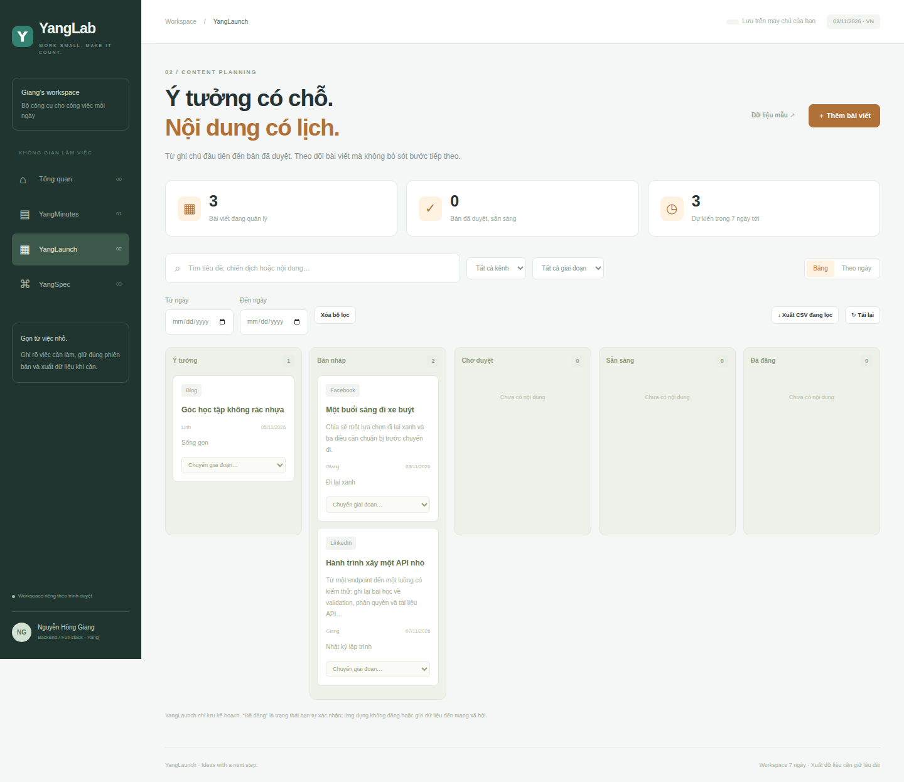
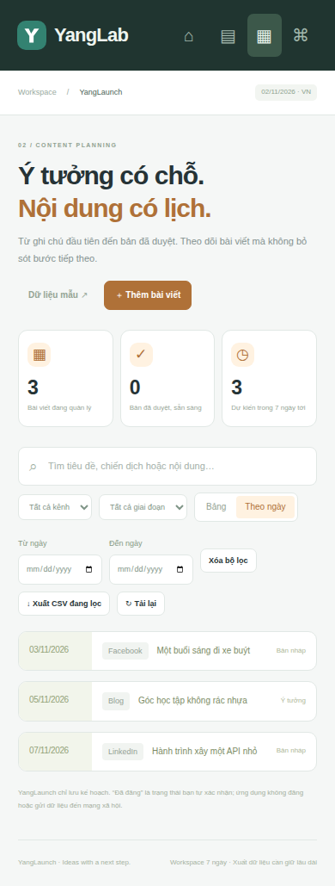

# YangLaunch

**Ý tưởng có chỗ. Nội dung có lịch.**

Ứng dụng kế hoạch nội dung trong [YangLab](../../README.md).
Chạy ở <http://127.0.0.1:3100/launch>.

## Luồng chính

- Tạo ý tưởng hoặc bản nháp, chọn chiến dịch, kênh, người phụ trách và ngày.
- Theo dõi bằng bảng hoặc danh sách theo ngày.
- Lọc từ khóa không dấu, kênh, giai đoạn và khoảng ngày.
- Chuyển bước: Ý tưởng → Bản nháp → Chờ duyệt → Sẵn sàng → Đã đăng.
- Trả về bước trước khi cần chỉnh: Chờ duyệt → Nháp; Sẵn sàng → Chờ duyệt;
  Đã đăng → Nháp.
- Xuất CSV đúng bộ lọc, hoặc xuất nội dung của bản đã lưu sang Markdown.

Không thể nhảy từ bản nháp sang đã đăng, kể cả qua endpoint PUT thay vì PATCH.
CSV escape các ô có thể thực thi công thức khi mở bằng bảng tính.

Với X/Thread, phân cách các đoạn bằng dòng gồm ba dấu gạch ngang.
Formatter giữ bốn dòng xuống hàng giữa các đoạn như nguồn MIT ban đầu.
Không tự gọi Typefully, không đăng mạng xã hội và không lưu khóa API.
Trạng thái Đã đăng do người dùng tự xác nhận.

## Nguồn và phần phát triển

Port hàm json_to_typefully_content của content_planner_flow/scheduler.py (MIT)
thành formatThread; thay workflow lên lịch bên ngoài bằng planner cục bộ có
approval flow, ownership, revisions, calendar và export. Xem
[NOTICE.md](../../NOTICE.md) và bản nguồn trong [upstream](../../upstream).

