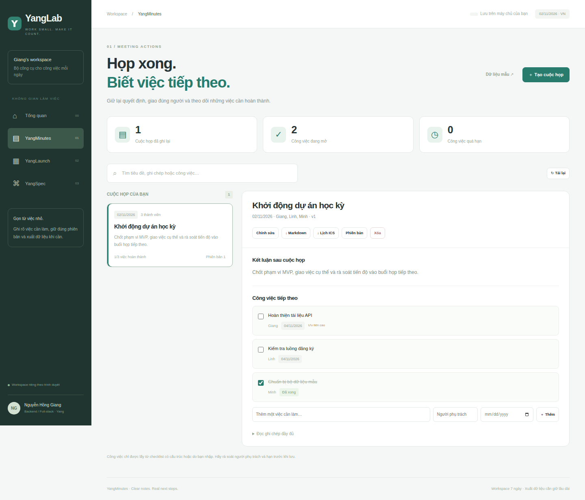
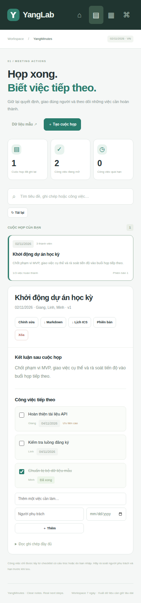

# YangMinutes

**Họp xong. Biết việc tiếp theo.**



Ứng dụng biên bản và công việc sau họp, thuộc monorepo [YangLab](../../README.md).
Chạy ở <http://127.0.0.1:3100/minutes> sau khi khởi động server ở thư mục gốc.

## Luồng chính

1. Tạo cuộc họp với ngày, thành viên, kết luận và ghi chép.
2. Nhập công việc thủ công hoặc lấy từ checklist có cấu trúc.
3. Rà soát danh sách, chọn dùng danh sách khi lưu.
4. Theo dõi người phụ trách, hạn và trạng thái hoàn thành.
5. Xuất biên bản Markdown hoặc công việc dạng ICS VTODO; xem revision khi cần.

```text
- [ ] @Giang | 2026-11-05 | Hoàn thiện tài liệu API
- [x] @Linh | 2026-11-06 | Chuẩn bị bộ dữ liệu mẫu
```

Parser chỉ đọc cấu trúc trên và báo dòng sai. Công việc không được tự suy ra từ
câu tự do. Mỗi cuộc họp tối đa 40 công việc, 16 thành viên và 40.000 ký tự ghi
chép. Công việc không có hạn không được đưa vào file lịch.

Chỉnh sửa có version để ngăn tab cũ ghi đè dữ liệu mới. Lịch sử giữ tối đa 20
phiên bản; xóa cuộc họp sẽ xóa cả lịch sử của cuộc họp.

## Nguồn và phần phát triển

Chuyển thể các trường ActionItem trong ví dụ meeting data models MIT của
patchy631, tiếp cận qua Trinhvhao. Viết mới runtime Node/SQLite, parser, UI,
ownership, version conflict và export. Không phải bản nhận dạng âm thanh
hoặc phân tích cuộc họp của upstream. [Thông tin nguồn](../../NOTICE.md).


