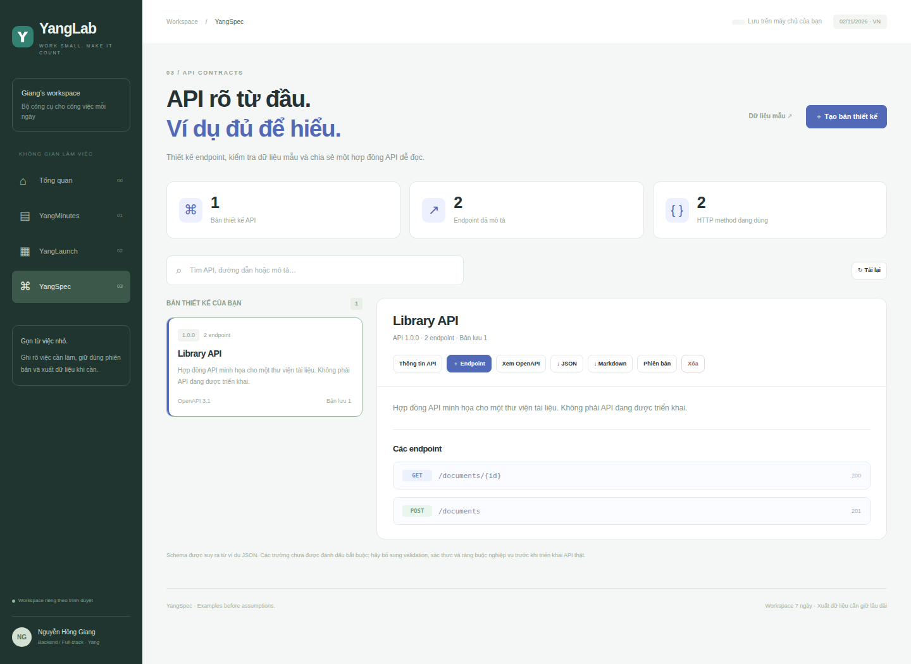
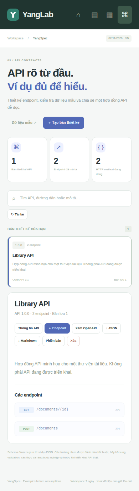

# YangSpec

**API rõ từ đầu. Ví dụ đủ để hiểu.**

Trình thiết kế hợp đồng API trong [YangLab](../../README.md).
Chạy ở <http://127.0.0.1:3100/spec>.

## Luồng chính

1. Tạo bản thiết kế với tên, phiên bản API và mô tả.
2. Thêm endpoint: method, đường dẫn, summary, status, request/response JSON.
3. Kiểm tra mẫu dữ liệu ngay khi lưu.
4. Xem và tải OpenAPI 3.1.0 hoặc tài liệu Markdown.
5. Xem lịch sử khi nhiều tab hoặc nhiều lượt chỉnh sửa.

Hỗ trợ GET/POST/PUT/PATCH/DELETE/HEAD/OPTIONS; tối đa 40 endpoint/bản thiết kế.
Path parameter được khai báo bắt buộc với kiểu chuỗi. Từ chối trùng operation,
đường dẫn mơ hồ khác tên parameter, JSON sai, JSON quá sâu, GET/HEAD có body,
phản hồi 204/304 có body và mã phản hồi ngoài phạm vi.

Schema suy ra primitive, object, array, null và array nhiều kiểu. Không tự đánh
dấu các thuộc tính object là required; dữ liệu mẫu không đủ để suy ra đầy đủ
nghiệp vụ. Đây không phải API server hoặc trình gửi request.

Browser test tải file OpenAPI từ UI và kiểm tra bằng Swagger Parser. Điều đó
không có nghĩa mọi hợp đồng do người dùng nhập đã được kiểm tra đầy đủ bằng
parser ở runtime.

## Nguồn và phần phát triển

Tham khảo title/description/examples từ DocPlan MIT trong documentation-writer-flow.
Runtime, endpoint editor, schema inference, OpenAPI exporter và validation được
viết mới cho YangSpec; không nhận bộ sinh tài liệu upstream là tự viết.
Xem [NOTICE.md](../../NOTICE.md).

